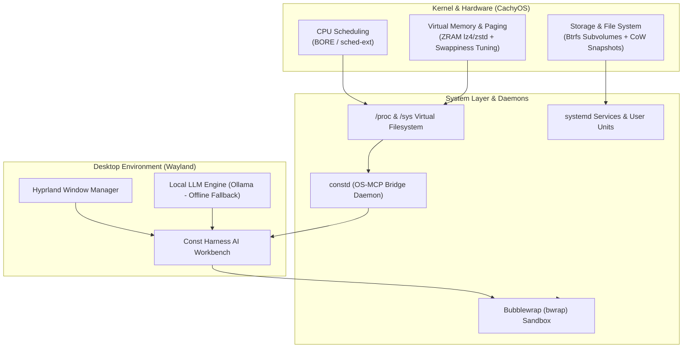

<div align="center">


# ConstOS

**Distribusi Linux berbasis CachyOS dengan Hyprland**

[](#)
[](#)
[](#)
[](#)

</div>

---

## Tentang ConstOS

ConstOS adalah distribusi Linux berbasis CachyOS untuk pengembangan perangkat lunak dan penggunaan desktop sehari-hari. Profil live awal menargetkan x86_64 UEFI dengan kernel CachyOS BORE, Hyprland, Waybar, dan swap ZRAM. Const Harness adalah integrasi yang direncanakan untuk edisi berikutnya.

---

## Arsitektur dan status pengembangan

Diagram berikut menunjukkan arsitektur yang dituju. Tabel di bawahnya membedakan komponen yang sudah disiapkan dari integrasi yang masih direncanakan atau perlu diuji.



| Komponen | Status |
| :--- | :--- |
| Kernel dan proses | Manifest live memilih kernel CachyOS BORE. Prototipe `constd` membaca load average dan sampel state proses. |
| Memori dan ZRAM | Overlay live mengatur `zram-generator` dengan `zstd`, `vm.swappiness = 100`, dan `vm.vfs_cache_pressure = 50`. |
| Storage dan recovery | Perkakas Btrfs dan Snapper masuk manifest. Penataan subvolume dan recovery pada sistem terpasang masih dalam pengembangan. |
| Telemetri dan integrasi Harness | `constd` punya prototipe HTTP GET/JSON. Integrasi dengan Harness dan transport MCP masih direncanakan. |
| Sandbox dan izin | Ada wrapper Bubblewrap yang menolak eksekusi saat `bwrap` tidak tersedia. Kebijakan akses dan integrasi agen masih perlu diuji. |

---

## Struktur Repositori

```text
ConstOS/
├── assets/                        # Logo dan aset visual ConstOS
├── docs/                          # Arsitektur distro & panduan teknis
│   ├── blueprint.md               # Rancangan arsitektur ConstOS
│   └── build-guide.md             # Panduan build ISO di lingkungan Arch/CachyOS
├── iso/                           # Mesin build ISO (Archiso + CachyOS profile)
│   ├── buildiso.sh                # Skrip utama generator ISO
│   ├── profiledef.sh              # Metadata ISO ConstOS
│   ├── pacman.conf                # Repositori paket CachyOS dan Arch
│   ├── packages.x86_64            # Manifest paket sesi live
│   └── airootfs/                  # Root filesystem overlay
│       ├── etc/os-release         # Identitas resmi ConstOS
│       ├── etc/systemd/zram-generator.conf
│       ├── etc/sysctl.d/99-constos-memory.conf
│       └── usr/local/bin/const-sandbox
├── desktop/                       # Konfigurasi antarmuka Hyprland
│   ├── hypr/                      # Konfigurasi Hyprland
│   ├── waybar/                    # Status bar dan metrik desktop
│   └── wofi/                      # App launcher
├── installer/                     # Rancangan konfigurasi dan branding Calamares
├── daemons/
│   └── constd/                    # Prototipe monitor /proc dan /sys
└── packages/                      # Packaging pacman untuk Const Harness (.pkg.tar.zst)
```

---

## Cara Membangun ISO

Lihat panduan lengkap di [docs/build-guide.md](docs/build-guide.md).

```bash
bash iso/buildiso.sh --stage-only
sudo bash iso/buildiso.sh -v
```

---

## Pengembangan

ConstOS dikembangkan oleh Alif Constantine. Urutan integrasi, target rilis, dan kriteria verifikasi ada di [roadmap pengembangan](implementation_plan.md).

ISO live sudah dibangun di Linux dan diuji di VM UEFI. Boot ke Hyprland, launcher, terminal, pengelola berkas, jaringan, ZRAM, dan console fallback berfungsi. Fokus berikutnya adalah Boot UI dan jalur instalasi ke disk.

---

## Lisensi

Proyek ini dirilis di bawah lisensi [GPLv3](https://www.gnu.org/licenses/gpl-3.0.html). Komponen Const Harness dilisensikan secara terpisah.
