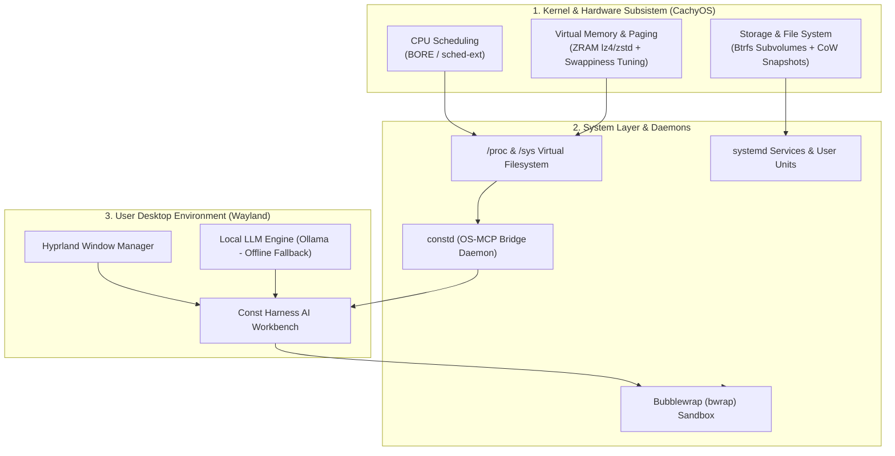

<div align="center">


# ConstOS

**Distribusi Linux berbasis CachyOS dengan Hyprland**

*Final Project Mata Kuliah Sistem Operasi (Ganjil 2026/2027) — Kategori A*

[](#)
[](#)
[](#)
[](#)

</div>

---

## 🌟 Tentang ConstOS

**ConstOS** adalah distribusi Linux berbasis **CachyOS** untuk pengembang perangkat lunak dan mahasiswa informatika. Profil live awal menargetkan x86_64 UEFI dengan kernel CachyOS BORE, Hyprland, Waybar, dan swap ZRAM. **Const Harness** adalah integrasi yang direncanakan untuk edisi berikutnya.

**Ryoku** digunakan sebagai referensi untuk pemisahan profil ISO, sistem terpasang, dan konfigurasi desktop. ConstOS punya repo dan riwayat pengembangan sendiri.

---

## ⚙️ Pemetaan 5 Konsep Inti Sistem Operasi

Diagram ini menggambarkan target akhir proyek. Status tiap komponen ada di tabel berikut.



| Konsep Inti Sistem Operasi | Status |
| :--- | :--- |
| **1. Process & CPU Scheduling** | Manifest live memilih kernel CachyOS BORE. Prototipe `constd` membaca load average dan sampel state proses. |
| **2. Memory Management & Paging** | Overlay live mengatur `zram-generator` dengan `zstd`, `vm.swappiness = 100`, dan `vm.vfs_cache_pressure = 50`. |
| **3. File System & Storage** | Perkakas Btrfs dan Snapper masuk manifest. Penataan subvolume dan recovery pada sistem terpasang masih dalam pengembangan. |
| **4. Inter-Process Communication (IPC)** | `constd` punya prototipe HTTP GET/JSON. Integrasi dengan Harness dan transport MCP masih direncanakan. |
| **5. Protection & Security** | Ada wrapper Bubblewrap yang menolak eksekusi saat `bwrap` tidak tersedia. Kebijakan akses dan integrasi agen masih perlu diuji. |

---

## 📁 Struktur Repositori

```text
ConstOS/
├── assets/                        # Logo dan aset visual ConstOS
├── docs/                          # Blueprint proyek & panduan teknis
│   ├── blueprint.md               # Master plan & arsitektur SO
│   └── build-guide.md             # Panduan build ISO di lingkungan Arch/CachyOS
├── iso/                           # Mesin build ISO (Archiso + CachyOS profile)
│   ├── buildiso.sh                # Skrip utama generator ISO
│   ├── profiledef.sh              # Metadata ISO ConstOS
│   ├── pacman.conf                # Repositori paket CachyOS dan Arch
│   ├── packages.x86_64            # Manifest paket sesi live
│   └── airootfs/                  # Root filesystem overlay
│       ├── etc/os-release         # Identitas resmi ConstOS
│       ├── etc/systemd/zram-generator.conf
│       ├── etc/sysctl.d/99-constos-memory.conf
│       └── usr/local/bin/const-sandbox
├── desktop/                       # Konfigurasi antarmuka Hyprland
│   ├── hypr/                      # Konfigurasi Hyprland
│   ├── waybar/                    # Status bar dan metrik desktop
│   └── wofi/                      # App launcher
├── installer/                     # Rancangan konfigurasi dan branding Calamares
├── daemons/
│   └── constd/                    # Prototipe monitor /proc dan /sys
└── packages/                      # Packaging pacman untuk Const Harness (.pkg.tar.zst)
```

---

## 🚀 Cara Membangun ISO

Lihat panduan lengkap di [docs/build-guide.md](docs/build-guide.md).

```bash
bash iso/buildiso.sh --stage-only
sudo bash iso/buildiso.sh -v
```

---

## 👥 Tim Pengembang

| No | Nama Anggota | Peran | Tanggung Jawab Utama |
| :---: | :--- | :--- | :--- |
| 1 | **Alif Constantine** | *Project Manager & Build Master* | Pipeline build ISO, koordinasi repositori, konfigurasi base Archiso. |
| 2 | *(Anggota 2)* | *Storage & Installer Engineer* | Modul Calamares Btrfs, konfigurasi bootloader GRUB/Plymouth. |
| 3 | *(Anggota 3)* | *Desktop Environment & UI Lead* | Konfigurasi Hyprland, Waybar studio monochrome, dan Wofi/Foot. |
| 4 | *(Anggota 4)* | *Application Integrator & Runtime Lead* | Packaging pacman Const Harness, systemd user services, Ollama offline. |
| 5 | *(Anggota 5)* | *System Daemon & Security Engineer* | Daemon `constd` (OS-MCP Bridge) dan isolasi Bubblewrap (`bwrap`). |
| 6 | *(Anggota 6)* | *QA, Benchmark & Documentation Lead* | Benchmark boot time, penyusunan Laporan Proyek Bab I–V, video demo. |

---

## 📄 Lisensi

Proyek ini dirilis di bawah lisensi [GPLv3](https://www.gnu.org/licenses/gpl-3.0.html). Komponen Const Harness dilisensikan secara terpisah.
