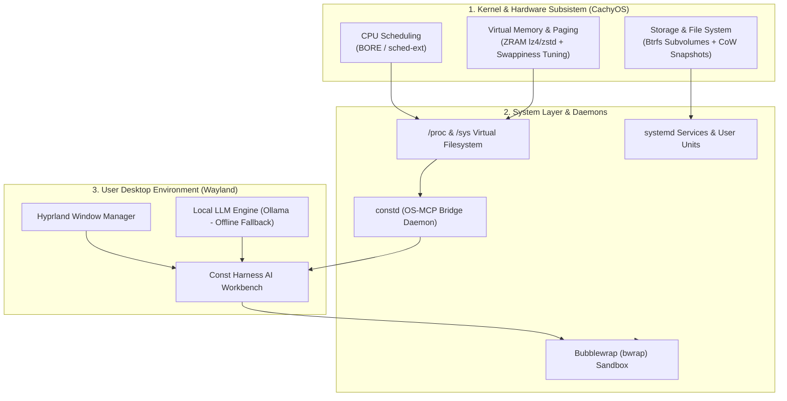

<div align="center">


# ConstOS (Harness Edition)

**Sistem Operasi Berbasis CachyOS dengan Wayland Compositor (Hyprland) & Terintegrasi Const Harness**

*Final Project Mata Kuliah Sistem Operasi (Ganjil 2026/2027) — Kategori A*

[](#)
[](#)
[](#)
[](#)

</div>

---

## 🌟 Tentang ConstOS

**ConstOS** adalah distribusi Linux turunan **CachyOS** yang dioptimalkan untuk pengembang perangkat lunak dan mahasiswa informatika. ConstOS memadukan keunggulan performa kernel CachyOS (BORE CPU scheduler & instruksi x86-64-v3/v4), keanggunan tiling compositor **Hyprland** bergaya *monochrome studio*, dan integrasi subsistem tingkat dalam dengan **Const Harness** (AI Desktop Workbench).

Berbeda dari distro konvensional yang memperlakukan AI sebagai aplikasi pihak ketiga biasa, ConstOS menghadirkan jembatan sistem lokal (**`constd`** / OS-MCP bridge) yang memungkinkan agen AI menginspeksi metrik kernel (proses, CPU ticks, alokasi memori, dan kompresi ZRAM) dalam ruang isolasi aman (**Bubblewrap `bwrap`**).

---

## ⚙️ Pemetaan 5 Konsep Inti Sistem Operasi

Distro ini dirancang dengan implementasi eksplisit terhadap 5 pilar sistem operasi:



| Konsep Inti Sistem Operasi | Implementasi Nyata di ConstOS |
| :--- | :--- |
| **1. Process & CPU Scheduling** | Menggunakan kernel CachyOS dengan scheduler **BORE (Burst-Oriented Response Enhancer)** yang mengoptimalkan interaktivitas desktop. State proses (`R`, `S`, `Z`) diekspos melalui daemon `constd`. |
| **2. Memory Management & Paging** | Mengaktifkan **`zram-generator`** (swap RAM terkompresi `zstd`/`lz4`) untuk meminimalkan I/O disk lambat, dipadukan tuning `vm.swappiness = 100` dan `vm.vfs_cache_pressure = 50`. |
| **3. File System & Storage** | Format default **Btrfs** dengan subvolume modern (`@`, `@home`, `@snapshots`), fitur *Copy-on-Write (CoW)*, serta snapshot pemulihan otomatis via **Snapper**. |
| **4. Inter-Process Communication (IPC)** | Daemon lokal **`constd`** bertindak sebagai OS-MCP Bridge, mengalirkan data status kernel ke antarmuka AI Workbench melalui UNIX socket / JSON-RPC. |
| **5. Protection & Security** | Terminal automated execution dari agen AI diisolasi dalam sandbox **Bubblewrap (`bwrap`)**, membatasi hak akses agen agar tidak dapat merusak rootfs (`/`, `/etc`). |

---

## 📁 Struktur Repositori

```text
ConstOS/
├── assets/                        # Logo dan aset visual ConstOS
├── docs/                          # Blueprint proyek & panduan teknis
│   ├── blueprint.md               # Master plan & arsitektur SO
│   └── build-guide.md             # Panduan build ISO di lingkungan Arch/CachyOS
├── iso/                           # Mesin build ISO (Archiso + CachyOS profile)
│   ├── buildiso.sh                # Skrip utama generator ISO
│   ├── profiledef.sh              # Metadata ISO ConstOS
│   ├── pacman.conf                # Repositori mirror CachyOS + repo lokal ConstOS
│   ├── packages.x86_64            # Daftar paket sistem, Hyprland, ZRAM, dan Harness
│   └── airootfs/                  # Root filesystem overlay
│       ├── etc/os-release         # Identitas resmi ConstOS
│       ├── etc/systemd/zram-generator.conf
│       ├── etc/sysctl.d/99-constos-memory.conf
│       └── usr/local/bin/const-sandbox
├── desktop/                       # Konfigurasi antarmuka Hyprland
│   ├── hypr/                      # hyprland.conf & modul konfigurasi (SUPER+H for Harness)
│   ├── waybar/                    # Status bar (Widget: ZRAM, CPU load, constd status)
│   ├── wofi/                      # App launcher
│   └── foot/                      # Terminal emulator
├── installer/                     # Calamares GUI installer custom Btrfs subvolumes
├── daemons/
│   └── constd/                    # OS-MCP bridge daemon (pembaca /proc & /sys)
└── packages/                      # Packaging pacman untuk Const Harness (.pkg.tar.zst)
```

---

## 🚀 Cara Membangun ISO

Lihat panduan lengkap di [docs/build-guide.md](docs/build-guide.md).

```bash
# 1. Masuk ke direktori iso
cd iso

# 2. Jalankan buildiso dengan hak akses root
sudo ./buildiso.sh -v -w work -o out
```

---

## 👥 Tim Pengembang

| No | Nama Anggota | Peran | Tanggung Jawab Utama |
| :---: | :--- | :--- | :--- |
| 1 | **Alif Constantine** | *Project Manager & Build Master* | Pipeline build ISO, koordinasi repositori, konfigurasi base Archiso. |
| 2 | *(Anggota 2)* | *Storage & Installer Engineer* | Modul Calamares Btrfs, konfigurasi bootloader GRUB/Plymouth. |
| 3 | *(Anggota 3)* | *Desktop Environment & UI Lead* | Konfigurasi Hyprland, Waybar studio monochrome, dan Wofi/Foot. |
| 4 | *(Anggota 4)* | *Application Integrator & Runtime Lead* | Packaging pacman Const Harness, systemd user services, Ollama offline. |
| 5 | *(Anggota 5)* | *System Daemon & Security Engineer* | Daemon `constd` (OS-MCP Bridge) dan isolasi Bubblewrap (`bwrap`). |
| 6 | *(Anggota 6)* | *QA, Benchmark & Documentation Lead* | Benchmark boot time, penyusunan Laporan Proyek Bab I–V, video demo. |

---

## 📄 Lisensi

Proyek ini dirilis di bawah lisensi [GPLv3](https://www.gnu.org/licenses/gpl-3.0.html). Komponen Const Harness dilisensikan secara terpisah.
