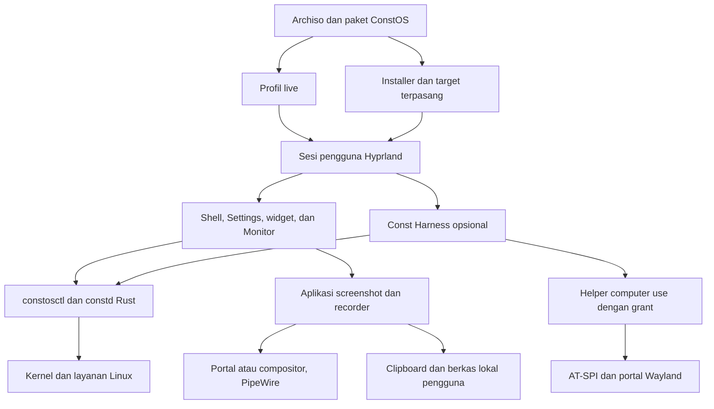

# Arsitektur ConstOS

ConstOS menargetkan desktop x86_64 UEFI berbasis CachyOS dengan Hyprland/Wayland. Desktop, installer, capture, dan diagnosis harus dapat digunakan tanpa akun AI, Harness, atau model lokal. Dukungan perangkat ditetapkan dari pengujian, bukan dari daftar paket.

Dokumen ini menjelaskan batas komponen dan arah desain. Status serta bukti penerimaan ada di [roadmap](../implementation_plan.md); cara membangun profil live ada di [panduan build](build-guide.md). Perubahan dokumentasi mengikuti [AGENTS.md](../AGENTS.md).

## Implementasi saat ini dan target

| Area | Implementasi saat ini | Target dan batas |
| --- | --- | --- |
| Build dan boot | Profil Archiso di `iso/`, kernel CachyOS BORE, GRUB UEFI, dan overlay live. Roadmap mencatat build Linux serta boot QEMU/OVMF. | CI Linux, Boot UI, dan bukti perangkat fisik. BIOS, Secure Boot, dan varian kernel/CPU bukan dukungan implisit. |
| Desktop live | Build menyalin Lua Hyprland dan konfigurasi Waybar, Wofi, Mako, Swaylock, serta Wlogout dari `desktop/`. | Shell/Settings Quickshell/QML masih perlu spike fokus, multi-monitor, aksesibilitas, dan performa. Fallback tetap tersedia selama cutover. |
| Screenshot dan media | Lua Hyprland/Waybar memanggil `grim`, `slurp`, dan `wl-copy`. Hasil capture belum tercatat teruji. | UI screenshot, editor anotasi, recorder video, dan recorder audio di fase 07A. Backend/format dipilih dari hasil uji; bukan layanan yang sudah tersedia. |
| Sistem dan storage | Konfigurasi ZRAM/sysctl serta manifest Btrfs/Snapper tersedia. Calamares masih berupa konfigurasi/branding. | Installer memasang target yang terpisah dari live; layout disk, snapshot, update, dan recovery dibuktikan sebelum diklaim. |
| Telemetri | Prototipe Python `constd` HTTP GET/JSON. | Satu collector Rust bersama, CLI `constosctl`, dan IPC sesi bertipe. HTTP lama dihapus ketika konsumen sudah bermigrasi. |
| Harness dan sandbox | Resep paket Harness dan wrapper Bubblewrap tersedia. | Paket Linux lengkap, helper computer use sesi pengguna, izin per capability, dan sandbox teruji. Keberadaan wrapper bukan bukti seluruh workspace/desktop sudah terisolasi. |
| Aset | Logo dan ikon berada di `assets/`; tema desktop berada di `desktop/`. | Token bersama, manifest asal/lisensi, ekspor terpakai, dan kepemilikan paket. Audit sumber aset masih diperlukan. |

## Alur target

Diagram ini adalah desain target, bukan inventaris layanan yang sudah berjalan.

## Tanggung jawab repositori

| Lokasi | Pemilik tanggung jawab |
| --- | --- |
| `iso/` | Profil Archiso, manifest live, boot, overlay, staging, dan pemanggilan `mkarchiso`. Artefak kerja/output bukan sumber konfigurasi. |
| `installer/` | Konfigurasi dan branding installer; kelak alur pemasangan target dan pembersihan komponen khusus live. |
| `desktop/` | Konfigurasi sumber desktop, keybind, tema, dan adapter sesi. Hanya file yang dipasang/dimuat boleh disebut efektif. |
| `packages/` | Resep paket serta kepemilikan file/default vendor. Paket bukan bukti executable upstream sudah disertakan. |
| `daemons/` | Prototipe daemon saat ini. Jangan menambah salinan collector baru untuk setiap UI. |
| `assets/` | Aset visual sumber/ekspor yang dipakai, dengan provenance dan lisensi yang perlu dicatat. |
| `docs/` | Arsitektur dan panduan teknis; tidak menyalin backlog atau menyimpan bukti media mentah. |
| `crates/`, `system/`, `tests/` | Lokasi yang direncanakan untuk Rust, kebijakan sistem, dan smoke lintas komponen; buat saat implementasinya diperlukan. |

`iso/buildiso.sh` saat ini men-stage `desktop/hypr/hyprland.lua`, bukan seluruh konfigurasi Hyprland lama. Mengubah file `.conf` yang tidak dimuat tidak mengubah sesi live. Periksa script dan konfigurasi aktual sebelum memigrasikan atau menghapus jalur lama.

## Batas proses dan kepercayaan

### Sistem lokal

Collector membaca data Linux sebagai pengguna biasa dan memberi hasil bertipe beserta status unavailable/error. CLI, Monitor, widget, dan Harness memakai kontrak metrik yang sama. D-Bus sesi menjadi arah integrasi stream UI; schema, versi, resync, dan lifecycle ditetapkan ketika implementasi dibuat.

Aksi yang memerlukan elevasi tidak dicampur dengan pembacaan metrik. Gunakan method sempit, validasi parameter, otorisasi per operasi, serta hasil aktual. UI tidak menganggap perubahan sukses hanya karena request terkirim. Jangan menambahkan listener jaringan atau aturan polkit tanpa password untuk menyederhanakan integrasi.

### Capture pengguna

Screenshot dan rekaman adalah aksi eksplisit pengguna desktop. Aplikasi yang sudah tersedia menangani capture/encoding; shell mengintegrasikan launcher, shortcut, preferensi, status, dan Stop. Hindari daemon capture custom sebelum ada kebutuhan yang tidak dapat dipenuhi backend yang diuji.

Pisahkan akses layar, mikrofon, audio sistem, dan berkas. Jalur portal mengikuti picker/consent backend; capture langsung dari compositor memiliki cakupan akses sesi yang berbeda dan harus dinyatakan demikian. Meng-crop gambar tidak mempersempit izin sumber yang sudah diterima.

Satu pemilik status menyinkronkan recorder, panel, dan notifikasi. Indikator aktif serta Stop tidak bergantung pada Island. Lock/logout/revoke melepaskan akses sumber; hasil baru dinyatakan selesai setelah finalisasi. Perilaku kegagalan, sumber hilang, format, dan playback mengikuti kontrak fase 07A.

Capture biasa tidak memberi izin computer use, tidak otomatis mengunggah hasil, dan tidak memasukkan frame/audio mentah ke log. Rekaman audio-only tidak meminta akses layar. Dukungan screen sharing aplikasi lain diuji terpisah dari perekaman berkas.

### Harness dan computer use

Harness adalah aplikasi opsional dengan update melalui pacman untuk edisi distro. Helper berjalan sebagai user-session child melalui inherited stdio. Pilihan Rust adalah arah implementasi; adapter upstream harus tetap mematuhi handshake dan batas kemampuan yang tervalidasi.

Grant sementara memisahkan observasi semantik, visual capture, dan pengiriman input. Periksa target, sesi, capability, expiry, serta pembatalan pada setiap aksi. Portal/AT-SPI/compositor adalah batas kemampuan nyata: jangan menawarkan kontrol global bila scope dan consent tidak dapat ditegakkan. Stop, lock, logout, revoke, atau putusnya induk menutup akses terkait. Pengiriman data ke model eksternal perlu izin terpisah.

Sandbox terminal terpisah dari izin desktop. Jangan memberi workspace sandbox socket helper, descriptor portal, keyring, atau akses input global secara otomatis. `/dev/input`, `/dev/uinput`, kontrol root, dan sesi remote/unattended berada di luar jalur computer use rilis awal. Ollama/model lokal bukan dependensi desktop atau isi wajib ISO.

## UI, widget, dan aset

UI memakai token visual bersama, aksi bertipe, dan state aktual. Provider memiliki subscription/event serta kebijakan sampling; shell, Monitor, dan widget tidak memindai metrik yang sama secara independen. Error provider harus menjadi state lokal, bukan menjatuhkan shell.

Widget bawaan memiliki ID jenis/instance, schema preferensi, sumber data, aksi terbatas, dan lifecycle. Layout per-user dimigrasikan ketika upgrade atau output berubah. Plugin pihak ketiga tidak termasuk dukungan 1.0 sebelum model izin/kompatibilitas/isolasinya ditetapkan. Aksesibilitas QML, fokus, dan keyboard diuji sebelum toolkit dikunci.

Aset dipasang oleh paket yang memakainya. Manifest yang direncanakan mencatat asal, versi, lisensi, ID, ekspor, dan varian. Build menggunakan ekspor yang dikomit, tanpa memanggil layanan generasi gambar. Preferensi tema/wallpaper pengguna terpisah dari default vendor. Roadmap fase 06 menetapkan alur desain serta pemeriksaan visualnya.

## Konfigurasi, state, dan lifecycle sesi

- Paket memiliki default vendor; preferensi pengguna mengikuti XDG config, data persisten mengikuti XDG data, state mengikuti XDG state, dan resource sementara mengikuti runtime directory sesi. Path serta schema konkret ditetapkan bersama implementasinya.
- Tulis preferensi secara atomik, versikan schema, dan migrasikan tanpa menimpa pilihan pengguna. Seeder hanya membuat konfigurasi awal yang belum ada.
- Gunakan direktori media XDG untuk hasil capture sesuai pilihan pengguna. Jangan menyimpan rekaman atau rahasia di direktori runtime yang bisa hilang saat logout.
- Satu pemilik per service sesi, notification bus name, dan reservasi tepi layar. Jangan menjalankan dua panel/daemon setelah login ulang atau selama cutover.
- Impor environment dari sesi aktif; jangan hardcode nama display Wayland. Lock/logout harus memberi jalur penghentian akses capture dan computer use yang dapat diuji.
- Akun live, autologin, sudo khusus ISO, dan repositori sementara tidak diwariskan ke sistem terpasang. Recovery harus tetap bisa dijalankan melalui TTY ketika shell atau greeter gagal.

## Keputusan yang belum dikunci

Toolkit shell/Settings, backend screenshot/editor/recorder, format/codec, transport/schema IPC final, layout storage yang didukung, preset performa, dan matrix hardware memerlukan hasil spike atau pengujian. Catat keputusan, alternatif yang ditolak, konsekuensi, versi, dan bukti pada bagian arsitektur yang terdampak; roadmap menyimpan langkah serta gerbang penerimaannya.
