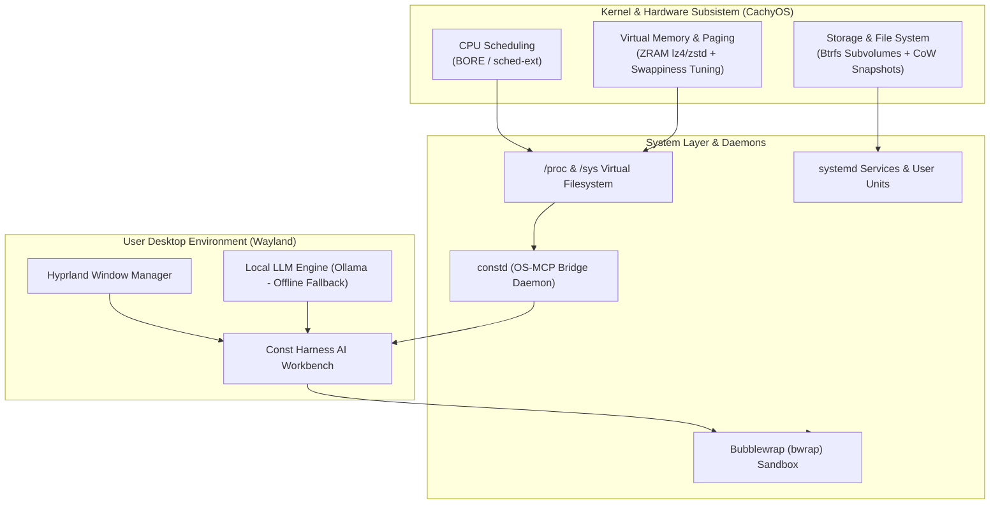

# ConstOS — Master Plan & Blueprint Proyek
**Final Project Mata Kuliah Sistem Operasi (Ganjil 2026/2027)**  
*Kategori A: Distro Linux dengan Visi Tertentu*

---

## 1. Identitas & Visi Proyek

* **Nama Produk:** **ConstOS** (Codename: *Harness Edition*)
* **Kategori Proyek:** Kategori A — Distro Linux dengan Visi Tertentu
* **Basis Sistem Operasi:** **CachyOS** (Turunan Arch Linux dengan optimasi kernel x86-64-v3/v4 dan advanced CPU scheduler)
* **Compositor / Desktop Environment:** **Hyprland** (Wayland Tiling Compositor)
* **Fitur Inti / Pembeda Utama:** Integrasi mendalam dengan **Const Harness** (AI Desktop Workbench), dilengkapi daemon sistem lokal (`constd` / OS-MCP bridge) dan sandbox keamanan untuk pengembang perangkat lunak serta mahasiswa informatika.
* **Visi Produk:** Menghadirkan sistem operasi pengembang modern berbasis Wayland yang ringan dan responsif, di mana AI workbench tidak hanya sekadar aplikasi terpasang, melainkan terintegrasi langsung dengan kernel subsistem (proses, memori, penyimpanan) secara aman melalui kontrol hak akses dan sandboxing.

---

## 2. Pemetaan Konsep Inti Sistem Operasi (Nilai Kompleksitas 50%)

### Rincian Penerapan 5 Konsep Inti SO:

1. **Manajemen Proses & Penjadwalan CPU (*Process & CPU Scheduling*):**
   * Menggunakan kernel CachyOS dengan scheduler **BORE (Burst-Oriented Response Enhancer)** atau kernel framework `sched-ext`.
   * Integrasi monitoring proses real-time: Agent Harness dapat membaca state proses (`R`, `S`, `Z` / Zombie), hierarki PID/PPID, serta mengatur prioritas komputasi via `nice` dan `renice`.
2. **Manajemen Memori (*Memory Management & Paging*):**
   * Mengaktifkan modul `zram-generator` berbasis kompresi cepat (`lz4` / `zstd`) di RAM untuk mencegah swapping disk yang lambat.
   * Tuning kernel parameter: `vm.swappiness = 100` dan `vm.vfs_cache_pressure = 50`.
   * Agent Harness memiliki tool untuk membaca status swap, alokasi page cache, dan mendeteksi proses yang berisiko memicu *Out-Of-Memory (OOM) Killer*.
3. **Manajemen Penyimpanan & Berkas (*File System & Storage*):**
   * Format default sistem: **Btrfs** dengan skema subvolume modern (`@` untuk root, `@home` untuk user, `@snapshots` untuk cadangan).
   * Fitur *Copy-on-Write (CoW)* dan snapshot otomatis menggunakan `snapper` sebelum proses pembaruan sistem (*system update*).
4. **Antarmuka Sistem & IPC (*Inter-Process Communication*):**
   * Pembuatan daemon/service lokal **`constd`** (atau implementasi MCP server ringan).
   * Daemon ini berkomunikasi dengan agent melalui standard I/O / JSON-RPC / UNIX domain socket untuk menyuplai status hardware, uptime, dan pembacaan `/proc` tanpa membutuhkan akses *root* penuh.
5. **Keamanan & Proteksi (*Protection & Security*):**
   * Isolasi Agen AI: Eksekusi terminal otomatis dari agen dibatasi menggunakan **Bubblewrap (`bwrap`)** atau profil **AppArmor**, sehingga agen tidak dapat secara tidak sengaja memodifikasi file sistem root (`/`, `/etc`, `/usr`).
   * Konfigurasi aturan **Polkit** untuk aksi administratif yang memerlukan izin eksplisit pengguna.

---

## 3. Komponen Teknis ConstOS

### A. Distro Core & Booting
* **Build Engine:** `archiso` dengan repositori resmi CachyOS.
* **Bootloader:** GRUB dengan tema custom ConstOS / systemd-boot.
* **Boot Splash:** **Plymouth** tema ConstOS.
* **Display Manager (Login Screen):** **SDDM** dengan tema monokrom studio Const.
* **Identitas Sistem:**
  * File `/etc/os-release`, `/etc/issue`, dan `/etc/lsb-release` bertuliskan *ConstOS*.
  * Konfigurasi **Fastfetch** dengan ASCII art logo ConstOS.
* **Installer:** **Calamares GUI Installer** yang dikonfigurasi skema partisi Btrfs otomatis dan branding ConstOS.

### B. Desktop Environment (Hyprland Wayland)
* **Compositor:** Hyprland (`hyprland.conf`) dengan konfigurasi tema monokrom studio:
  * Warna canvas `#161616`, border `#383838`, aksen `#ffffff`.
  * *Global Hotkey:* `SUPER + H` untuk memanggil Const Harness secara *floating centered* / *toggle*.
* **Status Bar:** **Waybar** dengan widget: CPU scheduler load, ZRAM utilization, status service `constd`, dan status baterai/jaringan.
* **App Launcher:** **Wofi** / **Rofi-wayland**.
* **Terminal:** **Foot** dengan preset font `JetBrains Mono` / `Geist Mono`.
* **Notifikasi:** **Mako**.

### C. Const Harness Integration
* **Packaging:** Aplikasi desktop dibangun menjadi paket pacman Arch Linux (`.pkg.tar.zst`).
* **Systemd User Unit:**
  * File unit `const-harness.service` untuk autostart background session saat login.
* **Offline Fallback Engine (Demo Safety):**
  * Bundling service **Ollama** di dalam ISO dengan model ringkas (misal: `qwen2.5-coder:1.5b` atau sejenisnya).
  * Menjamin demonstrasi di depan dosen penguji tetap berjalan 100% lancar walau tanpa koneksi internet kampus.

---

## 4. Pembagian Peran Tim (6 Anggota Kelompok)

| No | Peran | Tanggung Jawab & Rincian Tugas |
| :---: | :--- | :--- |
| **1** | **Project Manager & Build Master** | Mengelola repositori Git kelompok, mengatur pipeline build ISO, konfigurasi base packages, live filesystem, dan pembuatan bootable ISO. |
| **2** | **Storage & Installer Engineer** | Mengkustomisasi Calamares GUI installer, merancang skema partisi Btrfs subvolume, konfigurasi bootloader (GRUB/Plymouth), serta fstab & zram-generator. |
| **3** | **Desktop Environment & UI Lead** | Mengembangkan konfigurasi Hyprland, Waybar, Rofi/Wofi, lockscreen, tema login SDDM, serta branding visual (wallpaper, ikon, skema warna monokrom studio). |
| **4** | **Application Integrator & Runtime Lead** | Melakukan packaging pacman untuk Const Harness (`.pkg.tar.zst`), mengonfigurasi systemd user services, setup shortcut window manager, dan integrasi offline LLM (Ollama). |
| **5** | **System Daemon & Security Engineer** | Membangun daemon `constd` / MCP bridge untuk membaca subsistem `/proc` dan memori, serta merancang isolasi keamanan eksekusi agen menggunakan Bubblewrap (`bwrap`). |
| **6** | **QA, Benchmark & Documentation Lead** | Memimpin pengujian performa (benchmark waktu boot, penggunaan RAM idle, stabilitas), menyusun draf Laporan Akhir (Bab I s.d. V), membuat slide presentasi, dan merekam video demo 3–5 menit. |

---

## 5. Roadmap Eksekusi Proyek (4 Minggu)

* **Minggu 1 — Setup Repositori & Fondasi ISO:**
  * Inisialisasi struktur repositori ConstOS.
  * Uji coba build base ISO CachyOS menggunakan tool `archiso`.
  * Verifikasi ISO hasil build dapat di-boot di VirtualBox / QEMU.
* **Minggu 2 — Hyprland Environment & Visual Identity:**
  * Menerapkan konfigurasi Hyprland, Waybar, Foot, dan Wofi.
  * Pasang tema SDDM dan identitas sistem di `/etc/os-release` dan Fastfetch.
* **Minggu 3 — Integrasi Harness, Calamares & Daemon:**
  * Masukkan paket pacman Const Harness ke repository lokal ISO.
  * Buat daemon `constd` untuk membaca data `/proc` dan hubungkan ke prompt agent.
  * Konfigurasi installer Calamares dan validasi instalasi ke harddisk virtual.
* **Minggu 4 — Pengujian, Benchmarking & Penyelesaian Luaran:**
  * Pengujian performa: benchmark waktu booting (`systemd-analyze`), pemakaian RAM idle vs distro umum, uji beban ZRAM.
  * Penyusunan Laporan Proyek format PDF (10–20 halaman) sesuai sistematika Bab I–V.
  * Perekaman video demo 3–5 menit dan finalisasi slide presentasi.
