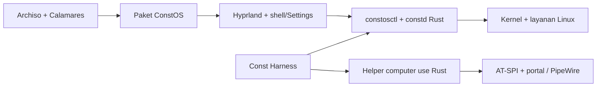

# ConstOS · Roadmap Pengembangan

**Baseline 6 November 2026** · CachyOS x86_64, UEFI, Hyprland/Wayland

ConstOS dikembangkan sebagai distro Linux untuk pengembangan perangkat lunak dan penggunaan desktop sehari-hari, dengan sistem yang bisa dipasang, diperbarui, dan dipulihkan serta antarmuka monokrom yang konsisten sejak boot. Const Harness menambah workbench dan akses lokal ke desktop dengan izin pengguna. Roadmap dimulai dari Boot UI dan berakhir saat artefak rilis, jalur update, dan recovery sudah teruji.

## Posisi sekarang

| Bagian | Yang sudah dikerjakan | Yang perlu dibuktikan atau dilengkapi |
| --- | --- | --- |
| Build ISO | Profil Archiso berhasil dibangun di Linux. GRUB UEFI dan initramfs memakai kernel BORE. Profil mempertahankan metadata rilis ConstOS saat paket basis dipasang. | Ulangi build dan smoke test di CI. Uji boot pada perangkat fisik. |
| Sesi live | QEMU/OVMF berhasil boot ke Hyprland dan Waybar. Foot, Wofi, Thunar, jaringan, ZRAM, dan console fallback sudah diuji. | Uji audio, portal, screenshot, dan lock. Audit sisa pengaturan khusus live sebelum membuat target terpasang. |
| Sistem dan installer | Ada konfigurasi ZRAM/sysctl, paket Btrfs/Snapper, serta rancangan Calamares dan branding. | Wiring installer, layout disk, konfigurasi Snapper, rollback, dan reboot dari disk masih menjadi pekerjaan berikutnya. |
| Telemetri dan AI | `constd` adalah prototipe HTTP GET/JSON lokal. Wrapper sandbox menolak eksekusi jika Bubblewrap tidak tersedia. Resep paket Harness ada di repo. | Ganti pembacaan metrik yang hardcode, satukan sumber `constd`, atur batas akses, dan pasang binary Harness yang benar. Profil live saat ini tidak mewajibkan Calamares, Harness, atau Ollama. |

Smoke test memakai VM QEMU/OVMF dengan 4 vCPU dan 3 GiB RAM. Kernel `7.3.1-1-cachyos-bore` berjalan di sesi Wayland, `systemctl --failed` melaporkan 0 unit gagal, dan `journalctl` bisa dibuka dari console fallback. Nama host live masih `CachyOS`. Instalasi ke disk dan boot perangkat fisik masih perlu diuji. [Panduan build](docs/build-guide.md)

## Target rilis

| Gerbang | Fase | Hasil yang bisa dipakai |
| --- | --- | --- |
| **A · Live Alpha** | 01–02 | ISO dari checkout bersih, Boot UI dan console fallback bekerja di UEFI, aplikasi inti bisa dipakai dalam sesi live. |
| **B · Installable Alpha** | 03–05 | Instalasi disk kosong, reboot tanpa ISO, desktop dengan konfigurasi yang bertahan, diagnosis dasar, dan panduan install/recovery yang dapat diikuti. |
| **C · Desktop Beta** | 06–10 | Menu dan Settings dengan aksi nyata, widget, Dynamic Island opsional, serta hasil uji perangkat dan baseline performa. |
| **D · Harness Beta** | 11–13 | Paket Linux Harness, monitor sistem, dan computer use lokal dengan scope, consent, Stop, dan batas kemampuan yang jelas. |
| **E · ConstOS 1.0** | 14–15 | Paket dan ISO bertanda tangan, update/rollback teruji, hardware yang didukung terdokumentasi, dan batas Harness dibuktikan di sesi Wayland nyata. |

Untuk 1.0, prioritaskan satu jalur resmi **UEFI x86_64 + Hyprland + CachyOS**. Jalur alpha memakai VM OVMF dan kemudian minimal satu laptop atau desktop fisik yang dicatat model GPU, storage, Wi-Fi, dan RAM-nya. Status NVIDIA, hybrid GPU, CPU lama, LUKS, dual boot, dan Secure Boot dilaporkan per skenario yang benar-benar lulus. Desktop dasar harus tetap bisa digunakan tanpa login Harness atau koneksi ke penyedia AI.

Nomor fase adalah urutan integrasi. Desain aset, prototipe shell, dan dokumen bisa berjalan bersamaan setelah fondasi yang dipakai masing-masing tersedia. Lakukan probe portal begitu sesi Wayland pertama bisa berjalan. Hasilnya menentukan scope Harness Beta sebelum tim mengerjakan UI izin dan kontrol input.

## Temuan dari Ryoku dan Const Harness

Referensi ini memakai Ryoku `v1.0.7` (`f7197d72d`) dan Const Harness dari monorepo `const` (`d77752fb`). Path di bawah relatif terhadap root repo masing-masing.

| Referensi yang dicek | Pola yang dipakai di ConstOS |
| --- | --- |
| Ryoku `installation/iso/build.sh`, `installation/tests/README.md`, `installation/backend/lib/filesystem.sh` dan `snapshots.sh` | Pisahkan staging, build ISO, dan instalasi target. Tes QEMU harus benar-benar melepas ISO, reboot, dan memeriksa filesystem, konfigurasi, serta paket hasil instalasi. |
| Ryoku `release/packages/ryoku-desktop/PKGBUILD`, `system/services/manifest.tsv`, `docs/updates.md` | Setiap default punya pemilik paket. Pengaturan pengguna diletakkan terpisah dari default paket. Enablement service, pengiriman konfigurasi, dan diagnosis drift memiliki alur yang bisa diuji. |
| Ryoku `docs/ui-ux.md`, `docs/launcher.md`, `docs/stage.md`, `ryoku/hub/quickshell/pages/DisplaysPage.qml` | Pakai token bersama, pisahkan launcher/panel/widget, dan beri pengaturan display mekanisme konfirmasi atau revert otomatis. |
| Ryoku `ryoku/shell/quickshell/shell/modules/bar/barstyles/kairos/Scene.qml` dan `components/Island.qml` | Kairos sudah memperlihatkan pola per-output, ruang tetap untuk bar, konten yang berubah ukuran, dan input mask. Pelajari prinsip itu untuk Dynamic Island ConstOS. Audit desain dan lisensi repo Windows saat tautannya diberikan. |
| Ryoku `ryoku/shell/plugin/systemmonitor.cpp` dan `docs/performance.md` | Pisahkan collector dari UI. Ukur PSS, CPU, wakeups, dan frame saat idle maupun saat panel terbuka sebelum menambah polling atau animasi. |
| Harness `apps/harness/desktop/package.json`, `apps/harness/DESIGN.md`, `apps/harness/UPDATES.md` | Desktop sekarang memakai Electron, React, TypeScript, Vite, dan `node-pty`. Build upstream punya target Linux pacman dan AppImage. Bawa style studio dan pola izin yang bisa dipahami, lalu buktikan paket Linux berisi runtime lengkap. Pada ConstOS, pacman menjadi pemilik update paket Harness. |
| Harness `apps/harness/desktop/native/README.md`, `native/computer-use-linux/runtime.py`, `electron/computer/computer-controller.ts` | Windows memakai PowerShell/Win32/UI Automation, macOS memakai Swift, dan Linux memakai Python/PyGObject/AT-SPI. Wayland saat ini mengiklankan aksi semantik terbatas. Pertahankan kontrak handshake, antrean request, lease, dan snapshot yang sudah ada saat menambahkan provider Wayland baru. |

## Pilihan arsitektur

**Pakai Rust untuk collector, CLI, dan helper computer use Linux.** Proses yang terpisah memberi tempat yang jelas untuk parsing bertipe, validasi request, pengelolaan file descriptor, dan lifecycle sesi. Izin Wayland ditentukan backend, compositor, dan consent. Performa diukur di fase 10. Konfigurasi Hyprland memakai Lua dan integrasi build memakai Archiso serta pacman.

| Keputusan | Arah yang dipakai untuk perencanaan | Cara menetapkan |
| --- | --- | --- |
| UI shell dan Settings | **Quickshell/QML** untuk spike launcher, panel, dan Dynamic Island. Gunakan token serta kontrak data yang sama untuk Settings dan Monitor. Waybar, Wofi, dan Mako menjadi fallback selama penggantian komponen berlangsung. | Bandingkan prototype QML dengan opsi GTK4/Rust + layer-shell jika dependensi, fokus, aksesibilitas, atau biaya render bermasalah. Selesaikan spike satu menu, satu kontrol, dan satu surface dua monitor sebelum mengunci toolkit. [Quickshell PanelWindow](https://quickshell.org/docs/v0.3.2/types/Quickshell/PanelWindow/) |
| Sistem lokal | `constosctl` untuk diagnosis. Rust `constd` memakai collector bersama dan D-Bus sesi saat UI membutuhkan stream metrik. Jalankan collector sebagai user biasa. Beri aksi sistem yang perlu elevasi method bertipe dengan izin per operasi. | Kirim satu pembacaan dari CLI terlebih dahulu, lalu sambungkan UI ke kontrak yang sama. Definisikan versi schema, pemilik data, dan perilaku saat service mati. |
| Harness desktop | Paketkan Electron yang ada terlebih dahulu. Tambahkan adapter Rust Wayland melalui host lokal yang ada. Tauri dapat dievaluasi belakangan untuk mengganti host desktop sambil memakai UI React yang kompatibel. | Keputusan pindah host memakai hasil pembandingan PTY, browser pane, streaming chat, storage/session restore, plugin/MCP, packaging, aksesibilitas, dan footprint. WebView tetap perlu diuji pada setiap platform yang didukung. [Arsitektur Tauri](https://v2.tauri.app/concept/architecture/) |
| Paket dan konfigurasi | Konfigurasi vendor dipasang lewat paket. Preferensi per-user memakai XDG config dengan schema versi. Data aplikasi, state, dan runtime dipisahkan. | Pakai paket yang sama untuk file yang memang dibagikan live/installed. Seeder hanya membuat file awal yang belum ada. Uji upgrade dari versi lama, config rusak, dan reset satu kelompok preferensi. |
| Izin computer use | Harness membuka helper user-session yang ditentukan paket melalui inherited stdio. Helper menerima izin sementara dari UI/portal dan melakukan pemeriksaan scope untuk setiap aksi. | Validasi satu target app dan satu sesi per lease. Backend mendeteksi kemampuan aktual dan menyajikan opsi yang tersedia. Hak root, listener jaringan, dan akses input global tanpa consent berada di luar kontrak. [RemoteDesktop portal](https://flatpak.github.io/xdg-desktop-portal/docs/doc-org.freedesktop.portal.RemoteDesktop.html) |

Gunakan `iso/`, `installer/`, `desktop/`, dan `packages/` sesuai tanggung jawab saat ini. Tambahkan `system/` untuk kebijakan target, `crates/` untuk kode Rust, dan `tests/` untuk smoke test lintas komponen ketika masing-masing dibutuhkan. Sumber helper Linux diusulkan berada di ConstOS dan dikirim sebagai paket versi tersendiri. Monorepo Harness memiliki adapter konsumennya. Tetapkan satu artefak binary per versi untuk kedua repo.

## Fase 01 · Boot UI dan bukti live boot

- [x] **Build baseline.** Build penuh di Linux menghasilkan ISO dengan checksum terverifikasi. Boot normal dan console fallback lulus di QEMU/OVMF.
- [ ] **Tema GRUB.** Buat entri ConstOS Live dan Console/Diagnostics yang jelas, timeout singkat, kontras terbaca, navigasi keyboard, logo, dan fallback teks. Uji nama kernel dan path initramfs pada setiap menu. Pisahkan theme loader dari entry boot supaya recovery bisa dibuka saat aset tema gagal.
- [ ] **Splash Plymouth.** Mulai dari satu logo dan indikator progres ringan. Integrasikan hook dan tema ke initramfs sesuai profil live serta preset target ketika installer tersedia. Pastikan log bisa dilihat, prompt disk terenkripsi tetap muncul saat fitur itu diaktifkan, dan perangkat tanpa grafis tetap memiliki jalur teks. [Plymouth](https://wiki.freedesktop.org/www/Software/Plymouth/) · [mkinitcpio](https://man.archlinux.org/man/mkinitcpio.8.en)
- [ ] **Greeter SDDM.** Tema QML memakai token visual yang sama. Sediakan user/session picker, keyboard layout, keadaan password salah, power menu, fokus yang terlihat, dan tema stock sebagai recovery. Autologin `liveuser` hanya di ISO. Sistem terpasang masuk dengan akun yang dibuat installer. [SDDM](https://github.com/sddm/sddm)
- [ ] **Boot asset kit pertama.** Mulai dari logo di `assets/` dan warna studio. Siapkan logo transparan kecil untuk initramfs, latar statis GRUB, dan latar greeter dengan crop untuk 16:9 serta layar lebih sempit. Jadikan generasi gambar sebagai tahap desain, lalu commit hanya ekspor yang dipakai dan manifest asalnya.

**Fase lulus jika** ISO dari checkout bersih boot sampai desktop dan console fallback bisa mengambil `journalctl -b`. Ulangi cold boot dengan tema, lalu cek sekali pada hardware target. Simpan satu tangkapan layar per tahap serta catatan durasi tanpa dan dengan tema. [Profil Archiso](https://github.com/archlinux/archiso/blob/master/docs/README.profile.rst)

## Fase 02 · Aplikasi bawaan dan layanan sesi

- [ ] Pisahkan manifest menjadi **live**, **installed core**, dan **opsional** saat installer mulai memakainya. Core live mengambil paket untuk sesi dan diagnosis. Installed core menambah kebutuhan harian yang dipilih. Toolchain pengembangan, Harness, model lokal, dan aplikasi besar memakai profil opsional dengan ukuran yang terlihat.

| Kelompok | Pilihan awal | Alur yang harus bekerja |
| --- | --- | --- |
| Desktop inti | Foot, Thunar, Wofi, Waybar, Mako, Swaylock/Wlogout | Buka terminal, file manager, launcher, notifikasi, dan lock/logout dari keyboard maupun mouse. |
| Harian | Firefox sebagai calon default, editor teks ringan, viewer gambar/PDF, pengelola arsip sesuai hasil uji paket | Buka URL, file, folder, gambar, dan PDF dari launcher atau Thunar. Asosiasi MIME dan ikon tampil konsisten. |
| Integrasi perangkat | NetworkManager, BlueZ dengan UI pairing yang diuji, PipeWire/WirePlumber, pavucontrol, portal Hyprland/GTK | Wi-Fi, pairing yang didukung, pengalihan audio output, file chooser, screen share, dan clipboard Wayland. |
| Diagnostik | `btop`, `fastfetch`, utilitas disk, dan kemudian `constosctl` | Lihat status hardware, kernel, memory, storage, dan log kegagalan dari TTY. |
| Opsional | Dev toolchain, editor IDE, Flatpak jika dipilih, Const Harness, serta engine/model lokal | Satu jalur pemasangan per aplikasi, ukuran dan dependensi tercatat, dan ada jalur uninstall yang mempertahankan data pengguna. |

- [ ] Periksa launcher `.desktop`, nama icon, kategori, file yang dipasang, dan `mimeapps.list`. Pastikan setiap menu menunjuk ke executable yang benar. Pilih backend portal secara eksplisit per interface setelah menguji sesi yang diluncurkan SDDM. [Desktop Entry Specification](https://specifications.freedesktop.org/desktop-entry-spec/latest/) · [portals.conf](https://flatpak.github.io/xdg-desktop-portal/docs/portals.conf.html)
- [ ] Definisikan service system dan user yang perlu aktif. Pisahkan autostart compositor dari service yang butuh supervisi. Impor env Wayland dari sesi aktual, hindari asumsi `wayland-1`, dan uji logout/login berulang agar proses panel, tray, dan notifikasi tidak ganda.

**Fase lulus jika** live VM bisa membuka halaman lokal dari browser, mengakses file dan arsip, menyalin teks/gambar, memindah audio output, dan menjalankan diagnosis dasar. Catat paket opsional dan pengaruhnya pada ukuran ISO.

## Fase 03 · Installer, sistem terpasang, dan recovery

- [ ] **Pilih satu jalur Calamares awal.** Rekomendasi online untuk UEFI dengan disk kosong. Tentukan paket Calamares yang dipakai dan bundel settings, modules, branding, serta launcher yang benar-benar dirujuk. Periksa versi ABI modul. Lakukan preflight jaringan, waktu, keyring, storage, dan sumber paket sebelum partisi dijalankan.
- [ ] **Pisahkan live dan installed.** Target menggunakan manifest dan paket konfigurasi yang ditentukan installer. Hapus akun live, autologin, aturan sudo live, unit khusus ISO, serta repo file sementara dari target. Aktifkan NetworkManager, display manager, dan layanan sesi yang diperlukan lewat jalur instalasi yang sama di VM dan perangkat fisik.
- [ ] **Kirim paket uji sejak installer pertama.** Buat `constos-desktop` minimal untuk konfigurasi yang dipakai target dan live. Pakai repo staging yang terkontrol untuk tes install dan update. Fase 14 membawa jalur ini ke penerbitan, penandatanganan, dan rotasi keyring.
- [ ] **Tetapkan layout disk.** Mulai dari GPT, ESP, dan Btrfs dengan layout `@`, `@home`, dan `@snapshots` jika integrasi Snapper lulus. Verifikasi mount, UUID, `fstab`, initramfs, dan bootloader target. Uji partisi pada disk VM kosong terlebih dahulu. Konfirmasi disk harus memakai identitas perangkat yang cukup jelas untuk membedakan dua disk berukuran sama.
- [ ] **Uji recovery.** Buat konfigurasi Snapper dan retensi yang terbatas. Uji restore satu file, lalu satu recovery sistem yang benar-benar bisa boot. Dokumentasikan batas snapshot untuk ESP, `/boot` terpisah, data pengguna, dan layanan dengan state eksternal. Simpan prosedur rescue dari ISO/TTY saat greeter atau compositor gagal.
- [ ] **Perluas mode satu per satu.** LUKS masuk setelah prompt unlock, suspend/reboot, dan recovery diuji. Offline install memakai snapshot paket dan keyring yang tersedia di ISO atau mekanisme lain yang dipilih dan diverifikasi. Dual boot masuk setelah uji OVMF dan disk dengan partisi yang harus dipertahankan.

**Fase lulus jika** tes QEMU melakukan instalasi, melepas ISO, reboot, login ke akun baru, dan memverifikasi kernel, jaringan, desktop, filesystem, ZRAM, serta update dari repo yang dipercaya. Simulasikan mirror gagal dan satu kegagalan instalasi yang dapat didiagnosis. Uji recovery hingga sistem masuk lagi.

## Fase 04 · Settings dan tindakan sistem

- [ ] Buat spike UI kecil untuk **Display**, **Audio**, dan **About**. Sambungkan masing-masing ke sumber data nyata. Tetapkan navigasi, pencarian Settings, error message, dan satu komponen form yang mendukung keyboard. Mulai About dari `os-release`, versi kernel/compositor, dan petunjuk diagnosis. Kaitkan ke Doctor lengkap pada fase 08.

| Halaman | Kontrol tahap pertama | Pemilik state atau aksi |
| --- | --- | --- |
| Display & Input | Scale, resolusi, refresh rate, posisi monitor, layout keyboard, touchpad, aksesibilitas | Hyprland dan konfigurasi per-user. Mode display disimpan setelah pengguna memilih **Keep** dalam countdown. Gagal atau timeout mengembalikan layout sebelumnya. |
| Audio & Perangkat | Volume, mute, input/output, brightness, Bluetooth status | PipeWire/WirePlumber, backlight yang tersedia, dan BlueZ. UI menampilkan perangkat yang hilang dan status izin. |
| Network | Wi-Fi, koneksi aktif, detail dasar, buka editor jaringan | NetworkManager. Kredensial dikelola oleh dialog/secret agent yang sesuai. |
| Appearance & Desktop | Tema, wallpaper, ukuran UI, reduced motion, panel, keybinds, widget, preferensi Island | Default paket dan override pengguna. Preview dapat dibatalkan. Konflik keybind terlihat sebelum Apply. |
| Power, Privacy & Session | Battery dan profil yang tersedia, idle/lock, notifikasi, akses computer use | UPower/logind, satu pengelola power profile, dan izin sesi Harness. Tombol Stop/revoke mengikuti status nyata. |
| System | About, status update, shortcut ke System Monitor dan Doctor, lokasi log | `constosctl`, sistem paket, dan service terkait. Kontrol sensitif dirilis setelah kebijakan serta pemulihannya lulus. |

- [ ] Buat kontrak bertipe untuk nilai, capability, perubahan, dan error. UI hanya menawarkan aksi yang valid untuk hardware dan sesi. Simpan user prefs dengan penulisan atomik dan migrasi schema yang bisa diuji ulang. Sediakan reset per bagian dan back up preferensi lama sebelum migrasi.
- [ ] Gunakan provider yang sudah menguasai subsistem melalui API atau adaptor sempit. Jalankan perubahan tingkat user dalam sesi. Untuk aksi sistem yang dipilih, pakai mekanisme otorisasi per operasi dan tampilkan kegagalan tanpa mengubah status UI menjadi sukses.

**Fase lulus jika** halaman Settings dapat apply/cancel dan mengembalikan layout display. Uji restart sesi, pengguna kedua, preferensi rusak, hardware hilang, dan perubahan dari luar UI. Pakai kontrak state yang sama untuk menu cepat ketika menu itu dihubungkan di fase 07.

## Fase 05 · Dokumentasi penggunaan dan pengembangan

- [ ] Perbarui README agar membedakan fitur yang sudah tersedia, diuji, dan direncanakan. Pertahankan `docs/build-guide.md` sebagai jalur build yang dapat direproduksi. Buat panduan install/first login, shortcuts, hardware/known issues, recovery, dan alur update ketika tiap fitur sudah bisa dijalankan.
- [ ] Buat panduan pengembangan untuk layout repo, pengiriman file via paket, pemisahan overlay live dan target, schema Settings, dan cara menjalankan tes VM. Simpan keputusan besar seperti pilihan shell, filesystem, dan provider computer use dengan pilihan, konsekuensi, dan hasil uji.
- [ ] Rapikan lisensi proyek dan inventaris komponen/aset. Saat mengadaptasi kode atau tema dari Ryoku, CachyOS, atau repo lain, catat path sumber, commit/tag, notice, lisensi, dan perubahan yang dibuat. Catat juga asal serta izin redistribusi font, icon, wallpaper, dan binary yang dipaketkan.
- [ ] Sediakan panduan pengguna dan pengembang dalam bahasa Indonesia, serta English untuk antarmuka/help utama. Petakan dokumen dukungan ke log yang dibutuhkan dan cara meredaksi nama pengguna, token, SSID, dan path sensitif.

**Fase lulus jika** pengguna atau kontributor baru mengikuti panduan dari clone atau ISO baru hingga login dan bisa menemukan prosedur diagnosis/recovery. Catat langkah yang gagal dan perbaiki dokumentasinya sebelum memberi label Installable Alpha.

## Fase 06 · Desain menu, identitas, dan pipeline aset

- [ ] Turunkan token ConstOS dari arah studio Harness dan logo yang sudah ada. Mulai dari canvas `#161616`, surface bertingkat, teks terang, satu aksen fungsional, radius, skala spacing, tipografi, fokus, dan durasi motion. Definisikan state hover, pressed, focused, pending, disabled, error, offline, dan selected. Terapkan tema lintas GTK, Qt, Foot, SDDM, dan shell sesuai kemampuan masing-masing toolkit.
- [ ] Buat wireframe yang saling terhubung untuk **Launcher**, **Quick Settings**, **Notification Center**, **Workspace/Tray**, **Power/Session**, **Desktop Context Menu**, dan **Welcome**. Bedakan permukaan yang selalu terlihat, yang muncul atas interaksi, dan yang boleh mengambil keyboard focus. Gunakan satu skala dan satu aturan closing lewat Escape atau klik luar.
- [ ] Pakai ImageGen nanti untuk eksplorasi wallpaper, tekstur, ilustrasi onboarding, dan latar boot/login. Simpan shortlist dan render final yang disetujui. Pakai vektor yang terbaca untuk ikon aksi serta logo, dengan raster fallback jika format boot membutuhkannya. Ekspor varian light/dark, crop untuk layar berbeda, dan ukuran yang sesuai target.
- [ ] Catat provenance, peran aset, source yang dapat disunting, file ekspor, ukuran, serta lisensinya. Uji keterbacaan teks di atas aset, ukuran initramfs, tampilan 100–200% scaling, tema terang/gelap, dan reduced motion. CI mengambil aset yang dikomit agar build tidak bergantung pada layanan generasi gambar.

**Fase lulus jika** review screenshot atau prototype mencakup boot, greeter, desktop, launcher, dan Settings dalam satu alur. Sediakan desain untuk state kosong, error, panjang teks terjemahan, keyboard-only, dan monitor kecil sebelum komponen dipoles.

## Fase 07 · Fungsi di balik menu dan shell

| Menu | Perilaku pertama yang dikirim |
| --- | --- |
| Launcher | Cari aplikasi, buka shortcut Settings dan Monitor, dukung riwayat/pinned items dan keyboard. Pakai mekanisme Desktop Entry untuk meluncurkan aplikasi. Sumber pencarian file/command dapat ditambahkan setelah ada opt-in dan batas direktori. |
| Quick Settings | Wi-Fi, Bluetooth, volume, brightness, Do Not Disturb, battery/power. Klik aksi memberi status pending lalu mengikuti state backend. Klik detail membuka halaman Settings terkait. |
| Notification Center | Tampilkan notifikasi, aksi asal, dismiss, dan DND. Pilih satu pemilik `org.freedesktop.Notifications` per sesi. Riwayat lokal punya batas dan dapat dihapus. |
| Workspace, tray, context | Pindah workspace, buka item tray, menu desktop untuk wallpaper/widgets/Settings, dan menu aplikasi dengan aksi yang didukung. Adapter Hyprland membaca event dan melakukan resync setelah compositor restart. |
| Power & Welcome | Lock, logout, suspend, reboot, shutdown dengan state capability dan konfirmasi yang sesuai. Welcome memberi shortcut dasar, pilihan tema/scale, tautan help, dan opsi untuk dilewati atau dibuka lagi. |

- [ ] Bagikan registry aksi dan state dengan Settings, keybind, widget, serta Island. Gunakan ID aksi dan parameter tervalidasi, dengan label terjemahan terpisah. Aksi UI memanggil adapter yang punya batas, agar string pencarian dan isi notifikasi tidak menjadi perintah shell.
- [ ] Pindahkan satu permukaan pada satu waktu dari Waybar, Wofi, atau Mako setelah pengganti lolos tes. Sediakan sesi fallback untuk pemulihan dari TTY. Pastikan applet tray, auth agent, dan notification daemon hanya dimulai sekali.

**Fase lulus jika** setiap item yang terlihat punya fungsi atau alasan disabled, hasilnya tampil kembali di UI, dan fokus pulih ke aplikasi sebelumnya setelah panel ditutup. Uji input cepat, monitor dicabut, daemon restart, izin ditolak, serta bahasa dengan label panjang.

## Fase 08 · System Monitor, Doctor, dan widget

- [ ] Tulis collector Rust dengan fixture dari Linux dan output `constosctl status --json` sebagai klien pertama. Saat paket Rust dan konsumennya siap, ganti dua salinan prototipe Python dan unit HTTP lama dengan satu sumber paket serta IPC sesi. Uji status pada akun biasa dan batasi respons pada metrik yang diperlukan UI.

| Metrik | Implementasi dan cara memeriksa |
| --- | --- |
| CPU dan scheduler | Hitung usage dari delta `/proc/stat` dan tampilkan load average terpisah. Tampilkan model, topology, frekuensi dan suhu bila tersedia. Bedakan kernel yang dikemas, mode scheduler yang dapat dideteksi, dan nilai yang tidak diketahui. Uji CPU hotplug, reboot counter, dan per-core saat ada beban. |
| Proses | Identitas proses memakai PID dan waktu mulai agar PID yang dipakai ulang tidak salah sasaran. Pindai sesuai izin, urutkan sebelum mengambil top-N, dan tangani proses yang keluar di tengah sampling. Tampilkan state dan RSS sesuai definisinya. |
| RAM dan paging | Gunakan `MemAvailable`, swap aktif, `/proc/pressure/memory`, dan statistik perangkat ZRAM. Baca algoritme yang aktif dan tunjukkan rasio kompresi terpisah dari biaya RAM perangkat. Tampilkan status unavailable jika file/fitur tidak ada. |
| Storage dan perangkat | Filesystem, mount, ruang bebas, I/O dari delta, status snapshot, GPU/suhu, battery, dan konektivitas sesuai capability. Bedakan perangkat fisik dan partisi agar I/O tidak terhitung dua kali. |

Sumber metrik dan batasnya dicatat bersama setiap collector. [Dokumentasi /proc](https://docs.kernel.org/filesystems/proc.html) · [Pressure Stall Information](https://docs.kernel.org/accounting/psi.html) · [ZRAM](https://docs.kernel.org/admin-guide/blockdev/zram.html) · [sched_ext](https://docs.kernel.org/scheduler/sched-ext.html)

- [ ] **Doctor.** Mulai baca-saja untuk unit gagal, versi kernel, display/session, portal, audio, jaringan, ruang disk, ZRAM, dan snapshot. Laporkan status, bukti, serta tindakan pemulihan yang dapat dipilih pengguna. Diagnostic bundle harus bisa dipreview dan meredaksi data pribadi sebelum dibagikan.
- [ ] **Widget tahap pertama.** Jam/tanggal, battery, jaringan, media MPRIS, dan CPU/RAM/ZRAM. Tambah widget disk dan aktivitas Harness setelah sumber datanya tersedia. Satu collector/subscription melayani panel, widget, dan Monitor. Gunakan event jika tersedia, kurangi sampling saat tersembunyi, dan berhenti ketika widget dihapus.
- [ ] Simpan posisi, ukuran, visibility, dan output. Batasi drag/resize ke work area. Jika monitor dilepas, pindahkan widget ke fallback yang dapat dijangkau. Sediakan preview, undo/reset layout, dan kontrol keyboard. Data privat seperti judul media atau task bisa disembunyikan di layar terkunci atau saat berbagi layar.

**Fase lulus jika** metrik sesuai dengan `btop`, `free`, `zramctl`, `findmnt`, dan sumber kernel yang sesuai pada interval pengukuran yang dicatat. Uji data kosong, hardware yang tidak didukung, proses yang keluar, service mati, widget yang ditutup, dan reboot yang mempertahankan layout.

## Fase 09 · Dynamic Island untuk Wayland

Mulai sebagai surface yang opsional dengan pola interaksi ConstOS. Saat referensi Windows diberikan, catat fitur yang menarik, perilaku saat hover/click, sumber event, dan ketentuan lisensi. Terjemahkan desain ke aturan Hyprland, termasuk work area, monitor, fokus, dan fullscreen.

| Bagian | Pilihan awal |
| --- | --- |
| Penempatan | Anchored di tengah atas monitor utama. **Floating** memakai zona non-eksklusif dan input mask. **Docked** mencadangkan strip atas yang tetap kecil. Reservasi berlaku pada tepi layar, sehingga ukuran panel yang membesar tidak dipakai untuk mengubah work area setiap frame. |
| State | **Idle** menampilkan waktu atau ringkasan kecil. **Peek** menunjukkan satu aktivitas singkat. **Expanded** membuka kontrol lengkap atas klik atau shortcut. **Hidden** mengikuti pengaturan, lock, dan fullscreen. Pemilihan konten dan animasi ditangani terpisah. |
| Prioritas | Kontrol capture dan Stop, peristiwa sistem penting, aktivitas Harness yang memang boleh ditampilkan, media, lalu waktu. Deduplikasi dengan Notification Center. Indikator computer use tetap tersedia lewat jalur terpisah jika Island mati atau tersembunyi. |
| Fokus dan input | Jangan ambil keyboard saat idle atau peek. Surface transparan hanya menerima input pada area yang terlihat/interaktif. Expanded dapat dibuka dengan shortcut, ditutup dengan Escape, lalu mengembalikan fokus. Sediakan alternatif klik untuk semua aksi hover. |
| Integrasi bar | Uji berdampingan dengan Waybar. Tentukan satu pemilik reservasi top edge dan satu provider untuk setiap data widget. Gunakan konfigurasi per-monitor saat dock/undock serta perbedaan skala. |

- [ ] Buat prototipe Quickshell kecil berisi jam, media, dan satu event palsu dari fixture. Ukur ukuran surface, hit test, frame pacing, dan penggunaan CPU saat diam. Tetapkan mode floating/docked setelah mencobanya pada browser, terminal fullscreen, dan aplikasi dengan top chrome.
- [ ] Hubungkan data nyata dari fase 07–08. Tambahkan kalender ringkas, timer, progress transfer, atau aktivitas Harness lewat kontrak event yang sama jika sudah ada backend. Tombol Stop meminta penghentian sesi ke broker dan menunjukkan hasil yang dikonfirmasi.
- [ ] Uji 1 dan 2 monitor, scale campuran, display kecil, hotplug, fullscreen, screen share, reduced motion, dan perubahan fokus cepat. Minimalkan alokasi ketika hidden dan hentikan animasi/polling yang tidak terlihat.

**Fase lulus jika** area transparan meneruskan klik ke aplikasi di bawahnya, fullscreen mengikuti kebijakan yang dipilih, work area tetap stabil saat ekspansi, dan seluruh kontrol dapat dipakai dengan keyboard. [Protokol wlr-layer-shell](https://github.com/swaywm/wlr-protocols/blob/master/unstable/wlr-layer-shell-unstable-v1.xml) · [Quickshell PanelWindow](https://quickshell.org/docs/v0.3.2/types/Quickshell/PanelWindow/)

## Fase 10 · Optimasi sistem dan dukungan perangkat

- [ ] Buat baseline sebelum dan sesudah shell baru di perangkat yang sama. Rekam kernel, compositor, versi paket, mode power, driver, resolusi, dan profil VM. Ukur cold boot hingga desktop siap, PSS sesi idle, CPU dan wakeups, latency launcher/Settings, frame pacing Island, dan idle/suspend drain pada laptop. Ambil beberapa run dan catat median serta sebarannya.
- [ ] Bandingkan desktop fallback dengan shell baru, Harness aktif/nonaktif, serta idle/beban kompilasi/pressure memori. Tetapkan budget awal setelah ada hasil. Pisahkan biaya kompresi, sampling, animasi, dan proses Electron. Optimasi event subscription, wakeups, serta polling tersembunyi sebelum mengubah tuning kernel.
- [ ] Uji ZRAM dan sysctl di VM dengan RAM terbatas dan satu perangkat fisik. Bandingkan pressure, jumlah swap, biaya RAM terkompresi, dan respons aplikasi. Catat nilai dari CachyOS dan override ConstOS yang betul-betul efektif. Terapkan tuning berbeda jika datanya mendukung perubahan itu.
- [ ] Kelola satu kebijakan power profile. Uji CPU governor yang disediakan perangkat, brightness, battery, idle, suspend/resume, audio setelah wake, display dan Wi-Fi. Untuk proses latar seperti Harness, evaluasi batas CPU/I/O/memori per unit user dengan cgroup v2 setelah ada beban nyata. Hindari pembatasan yang memutus kerja pengguna tanpa indikator. [cgroup v2](https://docs.kernel.org/admin-guide/cgroup-v2.html)
- [ ] Pertahankan pemilihan kernel dan repo generik saat memvalidasi hardware. Tambahkan fallback kernel atau tier CPU melalui keputusan yang memeriksa dukungan instruksi, driver, initramfs, dan rollback. Dokumentasikan kombinasi GPU dan firmware yang diketahui bermasalah. [Varian kernel CachyOS](https://wiki.cachyos.org/features/kernel/)

**Fase lulus jika** tersedia laporan sebelum/sesudah dengan perangkat dan beban yang sama, regresi besar punya penyebab serta keputusan, dan desktop masih dapat digunakan ketika beban memori atau I/O tinggi.

## Fase 11 · Paket Linux Const Harness

- [ ] Bangun upstream di Linux dengan `pnpm --filter @const/harness-desktop package:linux:pacman`. Periksa paket yang dihasilkan, executable, file `.desktop`, icon, resource native, dan dependensi `node-pty`. Pilih jalur konsumsi artefak paket yang sudah dapat diverifikasi atau PKGBUILD yang memasang artefak binary dengan checksum. Ganti resep lokal yang saat ini hanya membuat launcher ke `/opt/ConstHarness/const-harness-desktop`. [Resep paket saat ini](packages/const-harness/PKGBUILD)
- [ ] Uji instalasi dan upgrade pada target bersih. Dari launcher, cek startup di Wayland, PTY, pemilihan workspace, browser pane, clipboard, screen sharing aplikasi biasa, session restore, alur login/offline, serta data yang dipertahankan saat upgrade. Gunakan update pacman untuk edisi ConstOS dan sesuaikan perilaku update dalam aplikasi untuk paket distro.
- [ ] Jalankan Harness sebagai pengguna biasa dan sesuai sesi aktif. Jika pengguna memilih autostart, ikat lifecycle ke sesi dan impor variabel saat login. App tetap dapat digunakan ketika broker computer use tidak tersedia. Tampilkan kapabilitas berdasarkan hasil handshake dan izin runtime.
- [ ] Buat adapter Rust Linux dalam satu irisan kecil. Host Electron meluncurkan binary versi paket yang ditentukan dan membaca NDJSON dari inherited pipe. Pertahankan kontrak `ready`, `requestId`, handshake, error code, dan batas payload. Cocokkan perilaku dengan fixture yang sudah ada. Setelah host bisa memilih provider dengan aman, baru perluas kemampuan observasi.

**Fase lulus jika** paket bisa diinstal, dibuka, diperbarui, dan dihapus dari VM Linux dengan workspace yang tetap bisa diakses. Versi atau capability mismatch menghasilkan pesan yang dapat ditindaklanjuti. Uji workbench ketika computer use dinonaktifkan.

## Fase 12 · Native Computer Use, observasi lokal

Rust helper berjalan di sesi pengguna. Akses dibedakan per capability antara **melihat struktur aplikasi**, **menangkap gambar**, dan **mengirim input**. Jadikan izin sementara per target sebagai default, dengan pilihan menolak dan menghentikan sesi dari UI.

- [ ] **Spike kemampuan Wayland.** Dari ISO/instalasi target, catat versi Hyprland, XDPH, portal dan PipeWire. Probe apa yang benar-benar diiklankan lewat D-Bus. Uji ScreenCast dengan picker, scope window/output, serta apakah backend menyediakan RemoteDesktop dan `ConnectToEIS` atau metode input yang dibutuhkan. Dukungan protokol di spesifikasi perlu dibuktikan pada backend yang kita kirim. `InputCapture` menangkap input pengguna, sedangkan RemoteDesktop menyediakan jalur pengiriman input. [Pelacakan RemoteDesktop di XDPH](https://github.com/hyprwm/xdg-desktop-portal-hyprland/issues/252) · [RemoteDesktop](https://flatpak.github.io/xdg-desktop-portal/docs/doc-org.freedesktop.portal.RemoteDesktop.html) · [InputCapture](https://flatpak.github.io/xdg-desktop-portal/docs/doc-org.freedesktop.portal.InputCapture.html)
- [ ] **Observasi semantik.** Pakai AT-SPI dengan traversal berbatas, timeout, dan hasil per-app yang tervalidasi. Tangani aplikasi tanpa tree, role sensitif, ID window yang berubah, fokus, dan elemen yang hilang. Uji dengan fixture GTK/Qt serta satu aplikasi browser atau Electron. [Arsitektur AT-SPI](https://gnome.pages.gitlab.gnome.org/at-spi2-core/devel-docs/architecture.html)
- [ ] **Observasi visual.** Prototype Rust dengan `ashpd` dan PipeWire. Buka picker melalui jalur portal, pilih target, batasi ukuran, jumlah frame, masa berlaku snapshot, dan memori. Tunjukkan bahwa capture aktif. Jika backend hanya menawarkan monitor, jelaskan scope itu kepada pengguna dan minta persetujuan terpisah sebelum menggunakannya. Meng-crop frame setelah diterima tidak mengurangi scope yang disetujui di portal. [ScreenCast portal](https://flatpak.github.io/xdg-desktop-portal/docs/doc-org.freedesktop.portal.ScreenCast.html) · [Rust ashpd](https://docs.rs/ashpd/latest/ashpd/)
- [ ] **Privasi.** Default tanpa rekaman frame, teks yang diketik, clipboard, atau tree mentah pada log. Hasil pengamatan tetap lokal sampai pengguna memahami dan mengizinkan data yang dikirim ke model eksternal. Perlakukan teks di layar sebagai data yang bisa berisi instruksi asing. Tutup portal dan file descriptor saat pengguna menekan Stop, logout, lock, ganti target, atau proses induk putus.

**Fase lulus jika** target yang disetujui menghasilkan tree atau frame sesuai scope yang diberikan. Tolak, stop, revoke, dan hilangnya output menghentikan observasi dengan status yang jelas. Jika visual capture belum lolos, UI mengiklankan observasi semantik yang teruji.

## Fase 13 · Native Computer Use, aksi dengan izin dan sandbox

- [ ] **Aksi pertama melalui AT-SPI.** Uji klik semantik dan pengisian field pada aplikasi fixture. Setiap aksi memakai grant sementara dengan target, capability, sesi, expiry, dan aksi yang disetujui. Validasi ulang identitas window/elemen, status foreground saat relevan, koordinat, tipe input, serta snapshot terbaru sebelum pengiriman.
- [ ] **Input visual jika backend mendukung.** Uji klik, scroll, dan keyboard via RemoteDesktop/EIS atau jalur compositor yang bisa menegakkan scope dan consent. Catat transformasi koordinat antara stream, ukuran logis, scale, rotasi, dan target. Jika scope tidak bisa dijamin, batasi ke aksi semantik atau serahkan kontrol kepada pengguna. Akses root, `/dev/input`, dan `/dev/uinput` berada di luar jalur distribusi.
- [ ] **Lifecycle dan kontrol pengguna.** Satu lease aktif, antrean terserialisasi, deadline, pembatalan, rate limit, release tombol/modifier saat stop, serta pembacaan ulang state setelah aksi. Timeout setelah pengiriman menghasilkan status yang meminta observasi baru sebelum percobaan ulang. Sediakan Stop dengan shortcut dan kontrol UI yang tetap bekerja saat panel gagal.
- [ ] **Batas runtime.** Uji sandbox terminal Harness terpisah dari izin desktop. Ubah wrapper dari mount root luas menjadi daftar mount yang dibutuhkan, workspace terverifikasi, direktori sementara privat, kebijakan jaringan eksplisit, dan penolakan ketika isolasi tidak bisa diterapkan. Jalur sandbox tidak mendapat socket helper, file descriptor portal, agent SSH, keyring, atau data aplikasi secara otomatis. [Wrapper sekarang](iso/airootfs/usr/local/bin/const-sandbox)
- [ ] **Integrasi agen.** Tampilkan scope, status, dan perubahan di workbench. Untuk MCP, expose metrik baca-saja lebih dulu melalui adapter lokal yang benar-benar menjalankan handshake dan schema tool. Tool computer use lewat kebijakan broker yang sama. Nonaktifkan jalur remote/unattended untuk kontrol desktop pada rilis awal. Aksi destruktif, pembayaran, kredensial, sistem privilege, dan secure desktop berada di luar kapabilitas rilis awal.
- [ ] **Uji keselamatan.** Pakai aplikasi fixture dengan perubahan yang bisa diverifikasi. Uji salah target, popup asing, jendela pindah, multi-monitor skala campuran, izin ditolak, cancel saat aksi pending, timeout setelah aksi, aplikasi mati, dan sesi terkunci. Bukti keberhasilan berasal dari state aplikasi setelah aksi.

**Fase lulus jika** Harness menyelesaikan satu tugas lokal pada aplikasi fixture dan satu aplikasi sehari-hari yang tercatat didukung, dengan persetujuan, hasil terverifikasi, dan Stop efektif. Jika hanya aksi semantik yang lulus, cakupan itu menjadi dukungan resmi dan input global berstatus eksperimental.

## Fase 14 · Paket distribusi, update, dan rollback

- [ ] Finalisasi paket `constos-desktop`, `constos-core`, dan paket opsional Harness/helper yang dipakai di fase sebelumnya. Daftarkan kepemilikan file, dependensi, versi schema, script install, dan service. Installer memasang versi yang juga bisa di-upgrade lewat pacman. Gunakan default vendor yang dapat diidentifikasi dan simpan override di home pengguna.
- [ ] Hubungkan preflight staging dan tes VM dari fase 01–03 ke pipeline Linux yang juga mengompilasi Rust dengan lockfile, membangun paket, memvalidasi binary dan `.desktop`, lalu merakit ISO. Kaitkan SHA, versi repo/daftar paket, output hash, dan log CI. Tanda tangani rilis dari job tepercaya yang terpisah dari build PR. Uji keyring dan rotasinya sebelum membuka kanal stable. [Konfigurasi dan verifikasi paket pacman](https://man.archlinux.org/man/pacman.conf.5.en)
- [ ] Gunakan transaksi update sistem penuh untuk basis rolling. UI memberi status dan membantu menjalankan alur yang disetujui pengguna. Uji koneksi putus, keyring/mirror error, ruang disk habis, konfigurasi migrasi, paket ditolak, dan service perlu reload. Pastikan updater menunggu pekerjaan Harness yang relevan sebelum mengganti paket yang dipakai.
- [ ] Simpan satu kernel atau jalur boot pemulihan yang didukung serta riwayat artefak paket yang cocok. Latih downgrade paket ConstOS dan recovery sistem secara terpisah. Uji upgrade kernel yang menyentuh ESP atau `/boot`, lalu verifikasi versi modul, loader, dan initramfs setelah pemulihan. Tandai batas recovery data aplikasi dan snapshot di panduan.

**Fase lulus jika** kandidat rilis dapat diinstal, di-upgrade dari kandidat sebelumnya, dan dipulihkan. Bukti mencakup verifikasi tanda tangan, reboot sesudah update, preferensi pengguna yang bertahan, diagnosis kegagalan, dan satu rollback yang benar-benar boot.

## Fase 15 · Kualifikasi rilis dan ConstOS 1.0

| Pengujian rilis | Bukti minimum |
| --- | --- |
| Build dan boot | CI Linux menghasilkan ISO dari commit/tag, log tersimpan, SHA diverifikasi, UEFI VM dan satu perangkat fisik mencapai sesi, dan console recovery bekerja. |
| Install dan storage | Disk baru berhasil diinstal dan reboot tanpa ISO. Instalasi menyimpan akun dan layout yang benar. Snapshot, rollback, dan upgrade diuji. Skenario LUKS/offline/dual boot masuk daftar dukungan setelah memiliki bukti sendiri. |
| Desktop dan perangkat | Login/logout, launcher, semua aksi menu, display revert, file/MIME, audio, Wi-Fi, lock dan suspend diuji pada perangkat yang sesuai. Sertakan dua monitor, fractional scaling, keyboard-only, dan reduced motion untuk shell. |
| Metrik dan performa | Collector diverifikasi terhadap sumber kernel. Baseline mencakup boot, PSS/CPU idle, respons UI, pressure memori, dan beban kompilasi. Catat regresi serta hasil keputusan per build. |
| Harness dan izin | Paket berjalan di target. Demo memperlihatkan izin, observasi, aksi yang didukung, verifikasi hasil, Stop, dan penolakan di luar scope. Distro juga berfungsi saat Harness tidak dipasang. |
| Distribusi dan dukungan | ISO/paket bertanda tangan, checksum, release notes, known issues, hardware matrix, panduan install/update/recovery, inventaris lisensi, serta prosedur laporan bug dan keamanan tersedia. |

- [ ] Jalankan rilis kandidat di disk bersih dan pada versi sebelumnya. Bekukan perubahan UI selama verifikasi. Lakukan sign-off berdasarkan hasil tiap baris dan catat kegagalan penghalang rilis. Perbaiki kandidat, buat artefak baru, lalu ulangi tes yang terdampak.
- [ ] Verifikasi alur sistem pada kandidat rilis: monitor menampilkan state dan usage CPU nyata, ZRAM aktif dengan statistik aktual, recovery memulihkan perubahan dari snapshot, Monitor/Harness menerima data lokal, dan sandbox menolak operasi di luar izin. Pastikan sesi computer use berhenti setelah revoke. Catat hasil serta batas dukungannya dalam release notes.
- [ ] Publikasikan tag rilis, ISO, checksum/tanda tangan, paket, dan catatan rilis. Verifikasi download dari luar host build, instalasi baru, dan jalur update. Gunakan label dukungan yang sama di README, installer, dan Settings.

**ConstOS 1.0 siap ketika** seseorang di luar tim bisa mengunduh artefak, memverifikasi, memasang, login, menggunakan desktop sehari-hari, memperbarui, dan mengikuti recovery. Fitur Harness dipromosikan sesuai kapabilitas yang sudah lulus, dengan jalur penggunaan yang jelas ketika izin ditolak.

## Backlog pertama yang bisa dieksekusi

| Urutan | Perubahan | Bukti sebelum lanjut |
| --- | --- | --- |
| 1 | **Selesai.** Build baseline di Linux dan uji boot normal serta console fallback di QEMU/OVMF. | ISO, checksum, log build, dan bukti desktop serta TTY sudah diperiksa. |
| 2 | Otomatiskan smoke test untuk kernel, symlink, NetworkManager, SDDM, dan TTY. | Boot live berulang dari hasil staging bersih. |
| 3 | Tambahkan tema GRUB ConstOS dan entry diagnostics yang mudah dibaca. | Uji keyboard, timeout, normal boot, dan fallback. |
| 4 | Integrasikan Plymouth statis, lalu tema SDDM sebagai perubahan terpisah. | Uji tiap tahap tanpa mengaburkan log atau prompt, dan bandingkan durasi boot. |
| 5 | Lengkapi paket aplikasi bawaan dan uji launcher, file/MIME, audio, dan portal. | Satu sesi live yang dapat dipakai untuk alur dasar. Mulai installer setelah baseline ini jelas. |

Keputusan yang masih perlu data adalah daftar hardware yang akan didukung, pilihan aplikasi harian, aset Boot UI final, dan backend yang menyediakan cakupan input Wayland. Repo Dynamic Island Windows akan masuk review desain pada fase 09 setelah tautannya tersedia. Pemilihan toolkit shell dan migrasi host Harness dicatat sebagai keputusan berbasis spike agar pekerjaan yang sudah berfungsi tetap bisa dipakai selama pengembangan.
